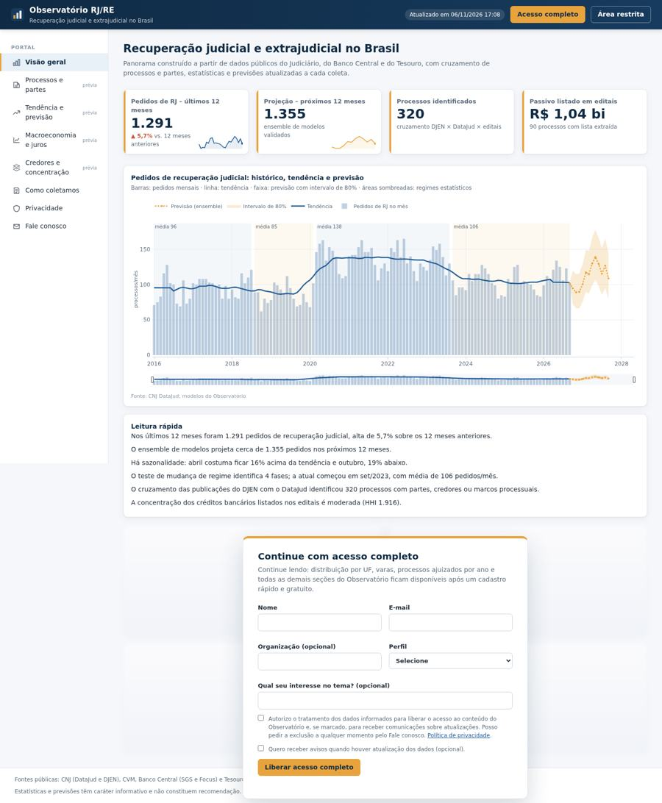

# Observatório RJ/RE

Portal de estatísticas sobre **recuperação judicial, recuperação extrajudicial e falência** no Brasil.
A ferramenta coleta dados de APIs públicas, **cruza as bases para identificar processos, partes, credores e grupos de empresas**,
calcula estatísticas e previsões e apresenta tudo em um portal web com prévia livre e conteúdo completo mediante cadastro.

> Repositório **privado**. Não contém dados: bases, cadastros, credenciais e arquivos de clientes ficam fora do controle de versão.


*Prévia com dados sintéticos.*

## Fluxo
```
coleta (APIs públicas) → cruzamento (processos, partes, grupos) → estatística → portal (prévia + cadastro + completo)
```
| Fonte | Uso |
|---|---|
| CNJ DataJud | contagens mensais por classe e tribunal; consulta processo a processo (classe, ajuizamento, órgão, movimentos) |
| CNJ DJEN | publicações sobre RJ/RE/falência (número, partes, CNPJs) e editais de credores (credor, classe, valor, banco) |
| CVM | companhias abertas em recuperação, falência ou liquidação |
| Banco Central (SGS e Focus) e Tesouro | juros, crédito, inadimplência, câmbio, atividade, expectativas e curva de juros |
| Observatório da Insolvência (ABJ/NEPI PUC-SP) | referência metodológica (não entra nos cálculos) |

## Destaques
- **Cruzamento**: processos identificados com partes, credores, marcos processuais, grupos de devedoras e companhias abertas, com regras que não presumem papéis nem identificam pessoas físicas.
- **Estatística**: decomposição sazonal, Holt-Winters, ensemble validado (MASE), mudança de regime, tempos processuais, Mann-Whitney, Kaplan-Meier, GLM binomial negativo, Granger, HHI, Gini/Lorenz, IC de Wilson – validados contra statsmodels/SciPy.
- **Portal**: prévia livre; cadastro do interessado ao fim da prévia (aplicado no servidor); página "Como coletamos" com status de cada fonte; página de privacidade.
- **Área restrita e administração**: carteira (edição interna), PSI, SAC, usuários, assinaturas, interessados, auditoria encadeada, 2FA.
- **Zero dependências**: só Python 3.9+ (biblioteca padrão) e JavaScript puro.

## Início rápido
```bash
python backend/cli.py diagnostico     # testa rede e fontes
python backend/cli.py mantenedor      # conta do mantenedor (senha + 2FA)
python backend/cli.py atualizar       # coleta + cruzamento + estatística
python backend/cli.py iniciar         # http://localhost:8750
python -m unittest discover -s tests -t .   # 26 testes
```
Windows: `DIAGNOSTICO_REDE.bat`, `CONFIGURAR_MANTENEDOR.bat`, `ATUALIZAR_TUDO.bat`, `INICIAR.bat`, `TESTAR.bat`.

## Documentação
[Revisão 9.0](docs/REVISAO_v9.md) · [Arquitetura](docs/ARQUITETURA.md) · [Segurança](docs/SEGURANCA.md) · [Publicação](docs/PUBLICACAO.md) ·
[API](docs/API.md) · [Guia visual](docs/ESTILO_VISUAL.md) · [Validação estatística](docs/VALIDACAO_ESTATISTICA.md) · [Histórico](CHANGELOG.md)
